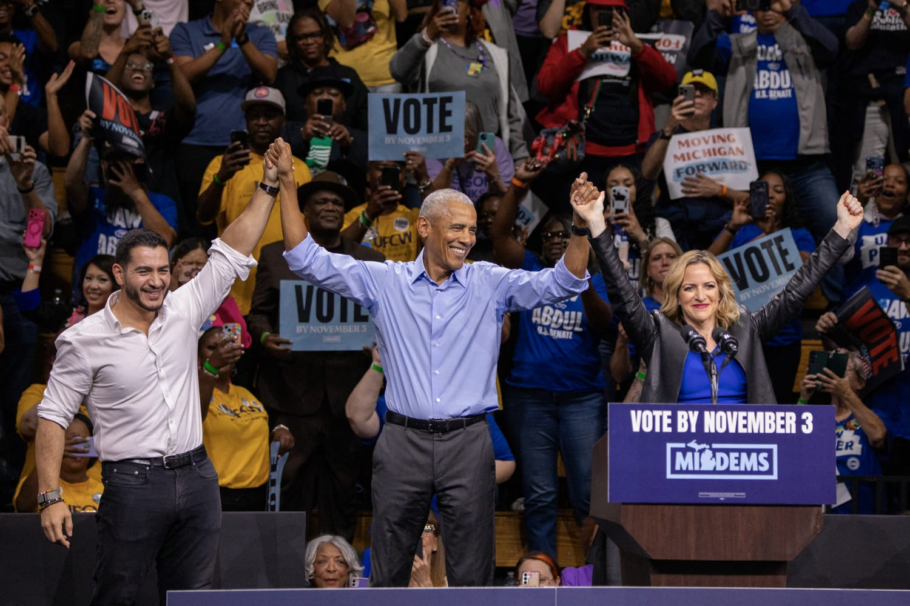

Here we are

## Trump’s America

We are going into Election Day with an America that is deeply divided, politically volatile, and more anxious about its future than any point I can remember. President Trump currently sits at an approval rating of approximately 38%, and the share of Americans who strongly support Trump has also fallen.

First and foremost, the economy has been stale in contrast with the economic renaissance he promised while the cost of living itself remains a massive concern. Inflation, tariffs, and gas prices have become emblematic of an administration consumed by the war in Iran, another rabbit hole with no clear exit in sight.

Combined with the abhorrently racist rhetoric from Republican leaders and corruption across all fronts, it is quite difficult to see a world where Republicans emerge from tomorrow’s elections with their congressional majorities intact. Trump himself does not want to come to terms with this idea either, as he has essentially completely lost it. He has been campaigning in deep red states and rambling on with nonsense at every rally. It is quite evident that Trump is unprepared for a post-Trump world, and these midterms will potentially be the beginning of the end.

## The Stakes

For Trump, losing either chamber would hamper his political dominance for his remaining two years in office. A flipped House would mean Democrats regaining the power to initiate impeachment proceedings against Trump and investigations into other federal officials for the unprecedented corruption and things like Hegseth’s handling of Iran. It would also make passing Trump's legislative agenda considerably more difficult. When it comes to the Senate, the possibility of two Supreme Court vacancies (Thomas and Alito) during Trump's presidency cannot be ignored. If Trump gets his picks, we will see an overwhelmingly conservative Supreme Court for probably another 40 years.

## Political Spending and Election Integrity

This cycle has been characterized by an outrageous amount of money flowing into the system. We are looking at over $2.77 billion put into these midterms by the 50 largest donors alone, with around 60% of it going to Republicans. Elon Musk alone has donated $472 million (and spent quite a bit of time fearmongering), setting a record that should not be seen as anything other than disturbing. Furthermore, organizations such as AIPAC and its affiliated super PAC, United Democracy Project, have poured millions into congressional races. Most notably, in Michigan's fiercely contested Democratic Senate primary, groups backing Haley Stevens outspent eventual Democratic nominee El-Sayed by tens of millions of dollars.

Another major point of discussion has been that of election integrity. We are seeing reports of potential voter intimidation and no one is really sure what will happen. Given their track record, Republicans will no doubt point fingers if it comes midnight and crucial races have not been called. It will be important for Democrats to prepare for these allegations, to stay calm, and to rigorously address any allegations.

## Some Key Beliefs:

- A polling lead of 2 to 3 percentage points is fragile and polling errors of 4-5 margin points can flip competitive races
- Polling errors can be correlated
- The incumbent party almost always loses seats in midterms
- The map matters

## The House

Predictions for the House have remained relatively stable for a while. Like most polls and analysts suggest, I am incredibly confident that Democrats will take the house. Nate Silver’s final generic-ballot average gives Democrats an advantage of roughly nine percentage points.

**Prediction: 239 D – 196 R**

Some key races to watch include VA-01, PA-01, KY-06, NY-17, TX-15, MI-07, CA-22, and IA-02. Recall that in 2024, Trump flipped Starr County, Texas Republican for the first time since the 1890s. In Duval, Florida, Trump reversed one of Biden’s big wins in which Democrats were able to get Jacksonville back for the first time since 1976. Additionally, Latino districts will be among the most revealing. Even in places where Trump did not win, gains in places that were once Democratic constituencies were an early nail in the coffin for 2024.

## The Senate

Unlike the House, control of the Senate has been significantly more uncertain throughout this cycle. A few months ago, it was nearly split on whether Democrats would win a majority. However, the climate has shifted considerably. Democrats now lead in the polling averages of virtually every major battleground state. While I agree with most of the polls on Texas, Ohio, Michigan, Maine, and Kansas, I believe Republicans will hold on to Iowa.

Let us break down some of the key battleground states.

**Michigan (El-Sayed vs. Rogers):** All of the news right now is about Haley Stevens' absurd last-minute endorsement of Mike Rogers, largely because of El-Sayed’s views on Israel. Because of how late it was, we have very little data on its impact. I do not think that it is going to be significant here, but it remains a repulsive choice. I have to say that it does not surprise me.

  

    
    

      Obama and Abdul El-Sayed in Detroit
    

  

I am however still concerned about El-Sayed’s ability to get Black voters in Detroit. A poll from September shows that 83% of Black voters want a Democratic majority, but only 67% wanted El-Sayed. Ultimately, there are a ton of factors at play here, and this is an election that is pretty much like nothing we have seen before.

**Texas (Talarico vs. Paxton):** James Talarico is a pretty standard establishment Democrat, but his religious background and populist approach will beat Paxton. The biggest issue in Texas right now, like many other states, is cost of living. Paxton is such a staunch ally of Trump, and if we are being honest here, it felt at one point like this election was going to be no more than a referendum on Trump even with Paxton’s scandals. However, there is evidence to suggest that Talarico is more popular with Democrats than Paxton is with Republicans. Keep an eye on the Latino voters. Keep an eye on Tarrant, Collin, and Denton, which will be key for getting a feel for what the wave actually is.

**Ohio (Brown vs Husted):** Sherrod Brown has a long history of working with blue-collar workers and organized labor groups; his approach is to appeal to unions and labor rights. Jon Husted has the ability to appeal to the working-class too, but is trying to do it from a pro-business angle, where he is supporting deregulation and tax relief. I think the level of optimism among voters without college degrees will decide this race.

**Alaska (Peltola vs Sullivan):** Within the last day, we have had another controversy break out over a “Decoy Dan” on the Alaska ballot. This is kind of annoying, but I do not think it is significant. I think the situation remains what it has been. Peltola has done a lot better than we thought she would within Alaska. Alaska is so unique and really kind of its own political environment because Peltola spends a lot of time on things that are specific to the state that other Democrats do not.

**Iowa (Turek vs. Hinson):** This has been the hardest race to call for me. The polling is very close, and I just do not see enough evidence that Josh Turek’s populist campaign is going to flip Iowa, a state that Trump comfortably won. He is honestly really quite boring, not very inspiring, and far from a moving speaker.

**Maine (Jackson vs. Collins):** Susan Collins is an experienced politician and one of the only Republicans left in this cycle who would even consider breaking party lines. This has been really a chaotic cycle after Graham Platner withdrew. Collins has outperformed the polls before and has the numbers in Maine to still win this. That being said, I do not think she will get the crossover support from Maine Democrats needed to retain her seat. Troy Jackson is a grounded person and I think he's the type of simple candidate Maine needed to challenge Collins. There were a lot of concerns about the little amount of time he'd have to turn things around, so we'll have to see how things turn out.

**Kansas (Hamilton vs. Marshall):** Kansas has been one of the biggest surprises of this election cycle. Adam Hamilton, a Methodist pastor, has been able to challenge incumbent Roger Marshall in a state that Trump won comfortably in 2024. Hamilton's religious background is also somewhat different from the rest of the Democrats, but something necessary to win in a place like Kansas. I'll be particularly interested in Johnson County and the Kansas City suburbs, where Democrats have made considerable gains in recent elections.

## References

<ol class="references">

<li id="ref-trump-approval">
N. Silver and E. McKown-Dawson, <i>Silver Bulletin</i> (2026). <a href="https://www.natesilver.net/p/trump-approval-ratings-nate-silver-bulletin" target="_blank" rel="noopener noreferrer"><i>How popular is Donald Trump?</i></a>.
</li>

<li id="ref-trump-video">
YouTube (2026). <a href="https://www.youtube.com/watch?v=zu5SWifVuY8" target="_blank" rel="noopener noreferrer"><i>WATCH: Trump doesn't commit to endorsing Vance for president in 2028</i></a>.
</li>

<li id="ref-political-donors">
C. E. Morse, L. Shapiro, P. Somasundaram, and E. Lau, <i>The Washington Post</i> (2026). <a href="https://www.washingtonpost.com/elections/interactive/2026/06/25/these-are-biggest-individual-donors-2026-election-cycle/" target="_blank" rel="noopener noreferrer"><i>Musk breaks donor record as the ultrarich pour $2.7 billion into the midterms</i></a>.
</li>

<li id="ref-musk-spending">
<i>The New York Times</i> (2026). <a href="https://www.nytimes.com/2026/11/02/us/politics/elon-musk-midterm-spending.html" target="_blank" rel="noopener noreferrer"><i>Elon Musk Tests What Nearly Half a Billion Dollars Can Buy in the Midterms</i></a>.
</li>

<li id="ref-musk-tweet">
E. Musk, X (2026). <a href="https://x.com/elonmusk/status/2116039632743702637?s=20" target="_blank" rel="noopener noreferrer"><i>Tweet</i></a>.
</li>

<li id="ref-flipr-forecast">
N. Silver and E. McKown-Dawson, <i>Silver Bulletin</i> (2026). <a href="https://www.natesilver.net/p/nate-silver-2026-midterm-election-polls-model" target="_blank" rel="noopener noreferrer"><i>FINAL FLIPR 2026 midterm election forecast</i></a>.
</li>

<li id="ref-michigan-poll">
E. Cox and S. Clement, <i>The Washington Post</i> (2026). <a href="https://www.washingtonpost.com/politics/2026/09/17/michigan-senate-race-poll-finds-abdul-el-sayed-has-narrow-edge-over-mike-rogers/" target="_blank" rel="noopener noreferrer"><i>We polled Michigan's Senate race. There's good and bad news for Democrats.</i></a>.
</li>

<li id="ref-texas-poll">
J. Henson and J. Blank, <i>The Texas Politics Project</i> (2026). <a href="https://texaspolitics.utexas.edu/blog/latest-ut-texas-politics-poll-finds-historic-levels-of-competition-in-texas-midterm-elections" target="_blank" rel="noopener noreferrer"><i>Latest UT/Texas Politics Poll Finds Historic Levels of Competition in Texas Midterm Elections</i></a>.
</li>

</ol>